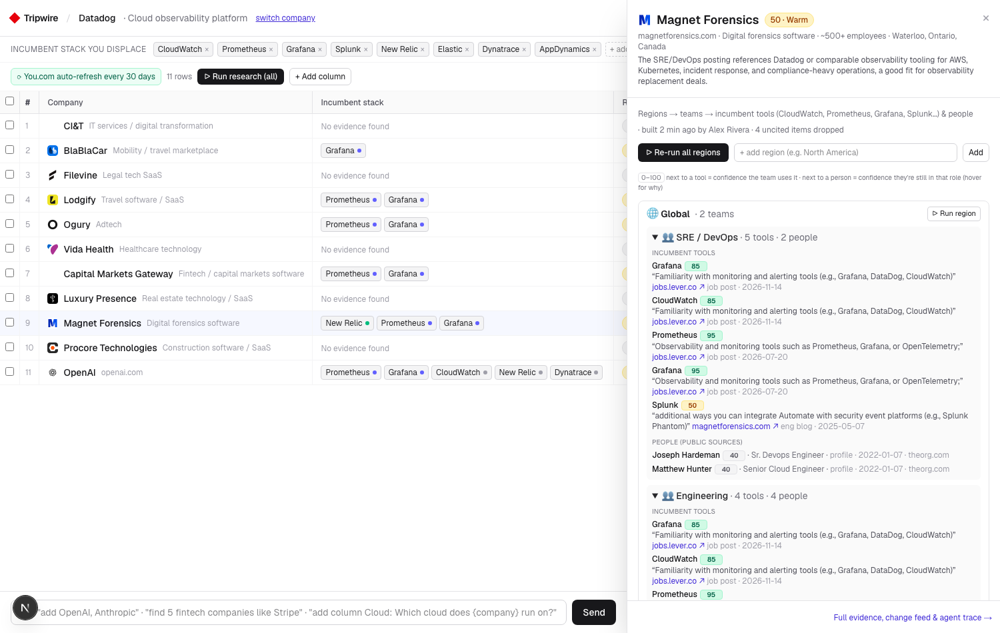

# Tripwire: live account intelligence with receipts

**Track: Live Wire** · Ground Truth: The Live Agents Hackathon (powered by You.com)

Tripwire tells a seller **which incumbent tools a target company runs today, which teams use them, who's on those teams, and why now**. Every claim links to a source, quotes it verbatim, and carries a date. Then Tripwire watches the account and reports what changed.



## How it works for any seller

1. **Start page:** "What does your company sell?" Pick a preset or describe your own. One **You.com Research** call (structured `output_schema`) returns your **incumbent stack** (the tools your buyers already run and you displace) and **10 ideal clients** with industry, HQ, size and why they fit. They become the first rows and start researching right away.
2. **Shared sheet:** one row per company. Columns: Company · **Incumbent stack** (each chip links to its receipt; dot = Confirmed / Strong / Inferred) · **Relevance** 0–100 · Evidence · Why they fit · Refreshed · your **AI columns**. The incumbent list is editable in the header.
3. **AI columns:** "+ Add column" with a prompt (e.g. *Which cloud provider does {company} run on?*). Every cell is answered by the **You.com Answer API** with citations. Columns can be edited (✎ re-runs them) or re-run (▷).
4. **Click a company → "People to call":** a lead table, **City · Team · Person · Title · In role (0–100) · Source**, sorted by confidence that the person is still in that role (computed from source type and how recently the role was confirmed; hover for why). Filter by region, **add a region** (e.g. "North America") and press **▷** to have **You.com Research** find people there; results merge into the list. Hovering a team shows the incumbent tools it uses, i.e. why that team is worth a call. **Copy CSV** exports the list for your dialer. Anyone whose source isn't among Research's returned sources is dropped.
5. **Reverse discovery ("who's hiring for Splunk?"):** `discover Splunk` in the chat (or `npm run research -- discover "Splunk"`, or the `discover_accounts` MCP tool) searches Greenhouse, Lever and Ashby job posts through **You.com Search** with query-level `site:` targeting, groups the postings by company slug, then **verifies each posting against that ATS's public, keyless job-board API** (`boards-api.greenhouse.io`, `api.lever.co/v0/postings`, `api.ashbyhq.com/posting-api`). A posting counts as verified only if it is still live and its full description names the tool, and the quote shown is copied straight from that description. Verified companies become rows and get researched.
6. **Chat bar:** `add OpenAI, Anthropic` adds rows and researches them; `add column Cloud: Which cloud does {company} run on?` adds a column; anything else (`find 5 fintech companies like Stripe`) asks You.com Research for more matching clients.
7. **Monthly refresh:** a server scheduler runs a You.com watch pass on every row whose last check is older than 30 days (`TRIPWIRE_REFRESH_DAYS`), adds new evidence, job posts and removed postings, and re-scores.


## The problem

Sales teams at challenger vendors burn hours guessing at a prospect's stack. Static technographic databases are months stale and never show *why* they think a company uses Splunk. Tripwire reads the live web on demand (job posts, vendor case studies, engineering blogs, news, and the company's own site code) and shows the receipts.

**Who pays:** AEs and SDR teams at any B2B software company that displaces an incumbent, priced per watched account per month.

## How it works

```
company + domain + watchlist
   │
   ├─ 1 Plan      8 targeted queries (ATS job boards, careers × incumbents/challengers,
   │              migration language, vendor case studies, company site, eng blog, last-month news)
   ├─ 2 Search    You.com Web Search, in parallel, deduped; consumer pages, aggregator
   │              search pages, vendor careers pages and "tool-as-employer" pages filtered out
   ├─ 3 Read      You.com Contents: top pages as Markdown + homepage as raw HTML
   ├─ 4 Detect    deterministic script-signature scan of homepage HTML ("Confirmed (site code)")
   ├─ 5 Extract   LLM → JSON evidence; every quote is checked against the page text and
   │              DROPPED if it doesn't appear verbatim (count shown in the trace)
   ├─ 6 Reconcile confidence (Confirmed / Strong / Inferred), stale > 18 months,
   │              migration signals, conflicts shown side by side (+ You.com Answer check)
   ├─ 7 Score     Displacement Score 0–100 with a transparent breakdown
   ├─ 8 Brief     You.com Research (standard): cited "why now" brief
   └─ 9 Snapshot  evidence + per-page tool fingerprints, for diffing
```

**Watch mode:** "Check for changes" (or auto-check every N minutes) runs a light pass: fresh job-board and news search (`freshness: week`), plus a live re-read (`max_age: 0`) of known job posts. It diffs against the last snapshot (new URLs, new tools, removed postings, job posts that now mention or stop mentioning a tool) and writes a timestamped, attributed change feed. Research is called again **only** when a new Strong/Confirmed signal appears.

**Team coordination:** accounts are keyed by normalized domain + category, and company names resolve to domains first. If a teammate owns the account, you see "*X is covering Y*" with **View shared research** (zero API calls) or **Request handoff**. If anyone researched it in the last 6 hours, the snapshot is reused, and the saved calls and dollars are tracked on the home page.

**Never fabricate:** no evidence shows as "No evidence found." Every item carries URL, verbatim quote (verified), source type and date (published if known, otherwise marked *fetched*).

## You.com endpoints → features

| Endpoint | Powers |
|---|---|
| **Web Search** `POST ydc-index.io/v1/search` | Discovery (incl. reverse ATS discovery with `site:boards.greenhouse.io OR site:jobs.lever.co OR site:jobs.ashbyhq.com`): `include_domains` for ATS boards (Greenhouse, Lever, Ashby, Workday), vendor sites and the company's own site; `freshness: month/week` for recent signals and watch mode; domain resolution for company names |
| **Contents** `POST ydc-index.io/v1/contents` | Full pages as Markdown for extraction; homepage as **HTML** for script detection (falls back to a plain fetch only if no `<script>` tags come back); `max_age: 0` live re-reads in watch mode |
| **Research** `POST api.you.com/v1/research` (`research_effort: standard`) | Onboarding (seller → incumbent stack + 10 ideal clients), chat "find more clients", the **org map** (regions → teams → tools & people, per-region runs), all via `output_schema`; cited "why now" brief per account |
| **Answer** `POST api.you.com/v1/answer` | AI prompt columns in the sheet (one cited answer per cell); quick cited check on the top conflict |

Every call is timed, cost-estimated at list price, capped per run (15 searches, 25 pages, 1 research, 1 answer), logged in the agent trace, and the run total is shown in the UI.

**LLM (extraction):** provider order is **You.com Inference Router** (same `YDC_API_KEY`, auto-detected via `GET /v1/models` each run; override the model with `TRIPWIRE_YOU_MODEL`), then the Anthropic API (`claude-opus-5-5`), then a **rule-based extractor** that only emits sentences copied straight from the page, with guards against reversed relationships (e.g. "Splunk uses Anaplan", or a Dynatrace job post that lists Anaplan as a skill). Whatever produces the JSON, every quote is then verified against the page text. The trace shows which extractor ran.

## For agents (MCP + CLI + JSON API)

Tripwire is built to be driven by other agents, e.g. parallel coding agents coordinated through an OpenCrawl board, as well as by humans. Agents and humans share one database, one ownership model and one cost log. See [AGENTS.md](AGENTS.md).

- **MCP server** (`.mcp.json` included): `research_account`, `check_for_changes`, `get_account`, `list_accounts`, `add_rows`, `add_prompt_column`, `get_sheet`, `map_org`, `discover_accounts`
- **CLI:** `npm run research -- "Anaplan" anaplan.com` → evidence JSON on stdout, trace on stderr; `npm run research -- discover "Splunk"` → companies hiring for Splunk with verified job links
- **HTTP:** `POST /api/research`, `GET /api/runs/:id`, `GET /api/accounts`, `GET /api/accounts/:key`, `POST /api/accounts/:key/check`

## Setup

```bash
npm install
cp .env.example .env.local   # add YDC_API_KEY (ANTHROPIC_API_KEY optional fallback)
npm run dev                  # http://localhost:3000
```

Data lives in `data/tripwire.db` (SQLite, git-ignored).

**Demo safety:** if a live run fails (e.g. wifi), the last good snapshot is shown and clearly labelled *CACHED*. The default demo run is live.


## Stack

Next.js 15 (App Router, TypeScript) · Tailwind · SQLite (better-sqlite3) · You.com APIs · Anthropic SDK · MCP TypeScript SDK
