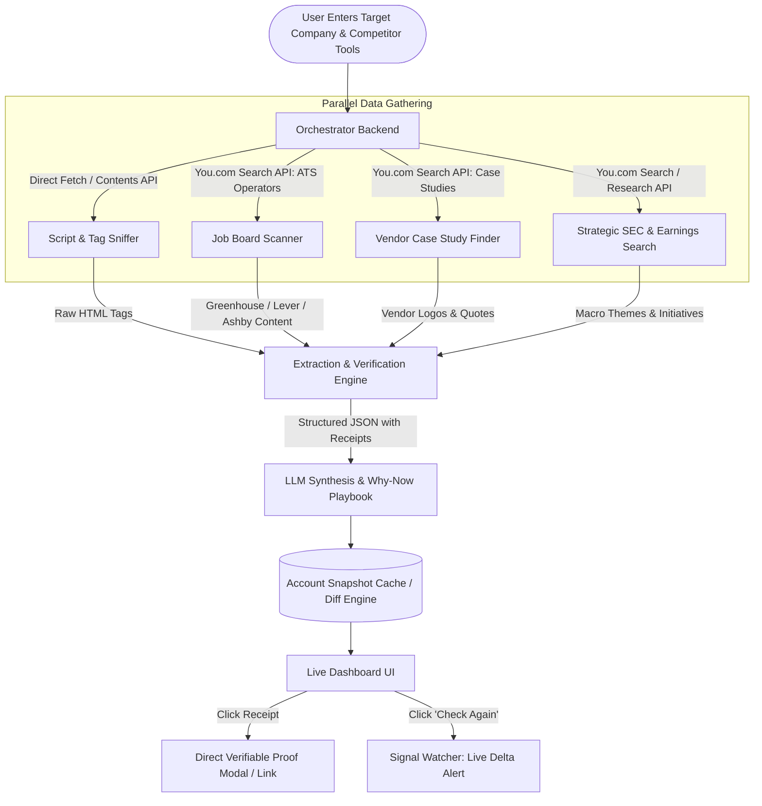

# Project "Receipts" (Live Wire)
## 2-Hour MVP Requirements Document & Execution Plan

---

## 1. Executive Summary & Hackathon Pitch

- **Product Name**: **Receipts** (Sales Intelligence on Live Wire)
- **Tagline**: *"Account intelligence where every claim has receipts."*
- **The Core Problem with static technographic databases**: They offer millions of company profiles, but claims are opaque, often outdated, and lack verifiable provenance. Reps pitching six-figure software cannot risk reaching out based on hallucinated or stale intelligence.
- **Our Value Proposition**: On-demand, real-time sales intelligence for *any* target account. Every detected tool, infrastructure migration, and hiring trigger is backed by **verifiable ground truth**: direct website script tags, active ATS job postings, vendor customer case studies, and corporate filings.
- **Why This Wins the Hackathon**:
  1. **Ground Truth First**: 100% of claims have clickable, highlighted evidence.
  2. **Live Wire / Real-Time**: Scans the live web right now instead of querying a stale database, plus a "Signal Watcher" that detects diffs over time.
  3. **High B2B Commercial Value**: Empowers outbound reps to target high-ACV migration windows (e.g., legacy Splunk to Datadog, or DocuSign to Terms.so).

---

## 2. The 3-Tier Proof & Confidence Hierarchy

Every signal displayed on the interface must be tagged with a confidence tier, a timestamp, and an interactive source receipt:

```
┌────────────────────────────────────────────────────────────────────────┐
│                        EVIDENCE HIERARCHY                              │
├─────────────┬─────────────────────────────────────┬────────────────────┤
│ Tier        │ Source Mechanisms                   │ Confidence Level   │
├─────────────┼─────────────────────────────────────┼────────────────────┤
│ Confirmed   │ • Direct client-side script tags    │ 🟢 100% Hard Proof │
│             │ • Official vendor case study pages  │                    │
│             │ • Company press releases (PR Newsw.) │                    │
├─────────────┼─────────────────────────────────────┼────────────────────┤
│ Strong      │ • Active ATS job postings           │ 🟡 85-95% High     │
│             │ • Company engineering blogs         │                    │
│             │ • Public GitHub org repositories    │                    │
├─────────────┼─────────────────────────────────────┼────────────────────┤
│ Inferred    │ • SEC 10-K/10-Q (Item 1C Infra/Sec) │ 🔵 70-80% Strategic│
│ ("Why Now") │ • Quarterly earnings call remarks   │    Context         │
│             │ • Executive conference keynotes     │                    │
└─────────────┴─────────────────────────────────────┴────────────────────┘
```

1. **🟢 Confirmed (Deterministic Hard Proof)**:
   - *Client-side script inspection*: Raw HTML scans detecting embedded vendor JavaScript (e.g., `cdn.segment.com`, `datadoghq-browser-agent.js`, `hs-scripts.com`, `onetrust.com`).
   - *Vendor customer proof*: Vendor-published case studies (e.g., `site:aws.amazon.com/solutions/case-studies/ "Disney"`).
2. **🟡 Strong (High-Fidelity Signal & Migration Language)**:
   - *ATS boards*: Scrapes Greenhouse, Lever, Ashby, and Workday postings.
   - *Migration language detection*: Pinpoints active replacement triggers: *"help us migrate off Splunk"*, *"deprecating legacy Informatica"*, *"modernizing from Jenkins to GitHub Actions"*.
3. **🔵 Inferred (Strategic "Why Now" Narrative)**:
   - High-level cost-cutting, cloud consolidation, or digital transformation initiatives pulled from earnings transcripts or 10-K disclosures.

---

## 3. High-Value Displacement Categories (Niche Selection)

To make the 2-hour demo punchy, we focus on high-ACV categories where legacy incumbents are vulnerable to challengers:

| Category | Incumbent (The Target to Displace) | Modern Challenger (The Buyer) | Detection Surface |
| :--- | :--- | :--- | :--- |
| **Observability & Logs** *(Recommended Demo)* | **Splunk, New Relic, Dynatrace** | **Datadog, Grafana, Honeycomb** | Job posts ("migrate off Splunk"), HTML script tags (Datadog RUM vs Splunk RUM) |
| **Data Pipelines & ETL** | **Informatica, Talend, Teradata** | **dbt, Fivetran, Snowflake** | Job specs ("modernize legacy ETL to dbt/Snowflake") |
| **Sales Tech / Contracts** *(Terms.so Demo)* | **DocuSign, PandaDoc** | **Terms.so, Concord** | Job posts, vendor case studies, public terms/contract URLs |
| **Frontend Analytics / Martech** | **Adobe Analytics, Marketo** | **PostHog, Amplitude, Customer.io** | Direct `<script>` inspection in target homepage HTML |

---

## 4. System Architecture



---

## 5. Functional Scope for the 2-Hour Sprint

### Piece 1: Target Input & Setup (Scope: 10 mins)
- Clean input interface:
  - **Target Company Name & Domain** (e.g. `disney.com` or `pagerduty.com`).
  - **Category / Competitors** (e.g. `Observability: Splunk, Dynatrace` or `Contracts: DocuSign, PandaDoc`).

### Piece 2: Client-Side Script & Platform Sniffer (Scope: 25 mins)
- Fast fetch of `https://{target_domain}`.
- Deterministic regex matcher for known script signatures:
  - Analytics: Google Analytics (`gtag`), Adobe Analytics (`adobedtm`), Segment (`analytics.js`), Mixpanel (`mixpanel`), PostHog (`posthog`).
  - Martech/Chat: HubSpot (`hs-scripts`), Marketo (`munchkin`), Intercom (`intercom`), Zendesk (`zendesk`), Drift.
  - Infra/Observability: Datadog RUM (`datadog-rum`), LogRocket, FullStory.
  - Consent/CMS: OneTrust, Webflow, WordPress.
- **Output**: Generates instant **🟢 Confirmed** receipts with exact tag string and line reference.

### Piece 3: ATS Job Post & Migration Scanner (Scope: 30 mins)
- Uses You.com Search API with operators:
  - `site:boards.greenhouse.io "{company}" OR site:jobs.lever.co "{company}" OR site:jobs.ashbyhq.com "{company}"`
  - `"{company}" careers ("{competitor}" OR "migrate" OR "modernize")`
- Fetches top 3-5 posting contents.
- Simple LLM extraction prompt:
  - Extract: Job Title, URL, Tools mentioned, Experience level.
  - Check for Migration Trigger: Does it contain replacement language (e.g. *"moving away from...", "replacing...", "experience transitioning..."*)?
- **Output**: Generates **🟡 Strong** receipts with exact job role, snippet, and direct application URL.

### Piece 4: Vendor Proof & Strategic "Why Now" (Scope: 20 mins)
- Search query: `site:{competitor_domain}/customers "{company}"` OR `"{company}" "{competitor}" (case study OR announcement)`.
- Pulls strategic context via You.com: What major transformation is the target undertaking?
- Produces:
  - 1-paragraph executive summary of the account's current stack.
  - Target Persona to contact (e.g., VP of Infrastructure or Head of RevOps).
  - Draft cold email citing the specific receipt:
    > *"Notice you're hiring for a Senior Data Platform Engineer to modernize legacy Informatica pipelines (posted 3 days ago on Greenhouse). Challenger X reduces that migration timeline by 60%..."*

### Piece 5: "Check Again" Signal Watcher / Diff Engine (Scope: 15 mins)
- In-memory/JSON snapshot storage of previous run (`snapshot_t0.json`).
- When user clicks **[Check for New Signals]**:
  - Re-runs scanner or loads a simulated delta state (`snapshot_t1.json`).
  - Highlights real-time diffs:
    - 🚨 `NEW SIGNAL (2h ago): New Job Posted: Staff SRE - Splunk Migration`
    - 🔄 `STACK UPDATE: Datadog RUM tag detected on /app checkout`

### Piece 6: Receipt-First Dashboard UI (Scope: 20 mins)
- Account header with company logo, domain, and last scanned timestamp.
- **Verified Tech Stack Grid**: Pill tags with confidence badges (🟢 Confirmed, 🟡 Strong).
- **Active Signals & In-Flight Migrations**: Alert cards highlighting replacement opportunities.
- **Interactive Receipt Drawer**: Clicking any card slides out the verbatim source snippet, publish date, and direct external link.

---

## 6. Minute-by-Minute 2-Hour Execution Roadmap

```
[00:00 - 00:30] Phase 1: Backend Scraper & You.com Search Connectors
[00:30 - 01:00] Phase 2: Script Sniffer & Migration Extraction Logic
[01:00 - 01:30] Phase 3: Frontend Dashboard & Receipt Cards
[01:30 - 01:45] Phase 4: Signal Watcher Diff Engine & Demo Caching
[01:45 - 02:00] Phase 5: Rehearsal & Pitch Alignment with Hackathon Criteria
```

### Detailed Breakdown:

#### ⏱ 00:00 – 00:30 | Phase 1: Rapid Backend Pipeline Setup
- Create a lightweight Python FastAPI or Node/Next.js backend.
- Connect You.com Search API (using provided API key).
- Build the 3 core search query templates:
  1. ATS Jobs: `site:boards.greenhouse.io OR site:jobs.lever.co "{company}" "{tool}"`
  2. Vendor Proof: `site:{vendor_domain} "{company}"`
  3. Strategic Context: `"{company}" (earnings OR "investor presentation" OR 10-K) "technology"`

#### ⏱ 00:30 – 01:00 | Phase 2: Deterministic Sniffer + LLM Extractor
- Implement HTML script tag sniffer (regex dictionary for instant Confirmed proof).
- Write structured LLM prompt (JSON output) for job post parsing:
  - Tool names, context, migration status (true/false), highlighted quote.
- Implement the "Why Now" synthesis prompt that outputs the ready-to-send outbound pitch.

#### ⏱ 01:00 – 01:30 | Phase 3: Frontend Dashboard (Tailwind + React / Streamlit)
- Build an ultra-clean UI layout:
  - Top Search Bar: Company + Competitor filters.
  - Section 1: "Why Now" Executive Summary & One-Click Outbound Angle.
  - Section 2: In-Flight Migrations (Red/Amber alert tags).
  - Section 3: Verified Tech Stack with Confidence Tags.
  - Section 4: Clickable Receipts (Source URL, Quote, Timestamp).

#### ⏱ 01:30 – 01:45 | Phase 4: Live Wire "Signal Watcher" & Demo Hardening
- Implement the "Check Again" button.
- Build snapshot comparison logic (comparing T0 vs T1).
- **Critical Hackathon Step**: Pre-cache 2 gold-standard demo accounts to prevent API latency or rate limits during the presentation:
  1. **Demo Account 1**: Disney (AWS confirmed partnership, Splunk/Datadog signals, streaming infrastructure modernization).
  2. **Demo Account 2**: Fast-growing SaaS / Design Agency (for Terms.so contract displacement or Datadog migration).

#### ⏱ 01:45 – 02:00 | Phase 5: Rehearsal & Judge Scorecard Alignment
- Rehearse the 3-minute pitch:
  1. *Hook (30s)*: Static technographic databases charge five figures a year for stale data you have to take on trust.
  2. *Live Demo (90s)*: Type target -> instantly see script tags (100% hard proof) + active migration job postings + generated outreach email with clickable receipts.
  3. *Live Wire Moment (30s)*: Click "Check Again" -> live diff highlights a newly opened role.
  4. *Close (30s)*: Static databases map the past; Receipts maps the present with verifiable proof.

---

## 7. Deliverables Checklist for Submission

- [ ] Working Web Application (Localhost or deployed URL).
- [ ] Live You.com Search API integration for ATS & Vendor proof.
- [ ] Deterministic HTML Script Tag detector for client-side tools.
- [ ] Receipt UI: Every claim has a working link and verbatim highlighted quote.
- [ ] "Why Now" Outbound generator with cited trigger.
- [ ] "Check Again" Live Signal diff demonstration.
- [ ] 2 Pre-warmed accounts for zero-latency demo reliability.
